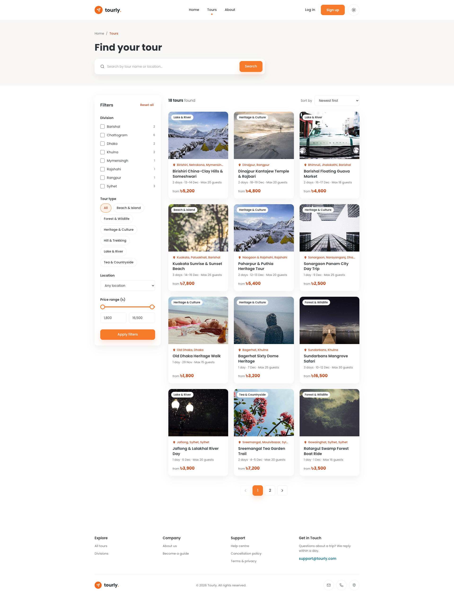
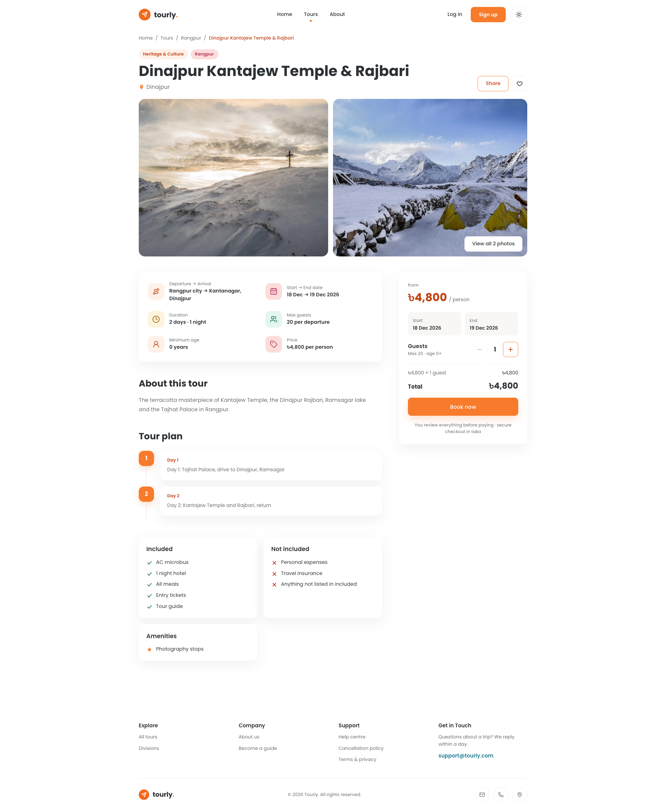
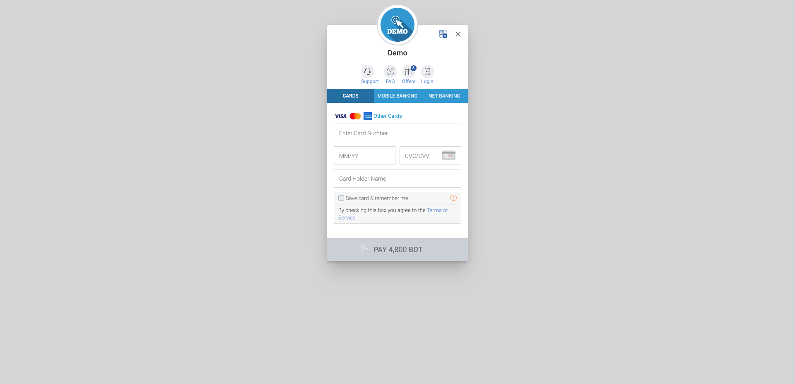
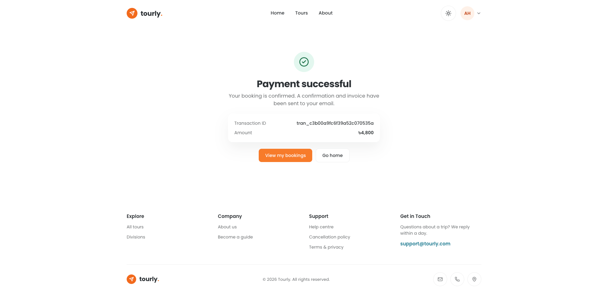
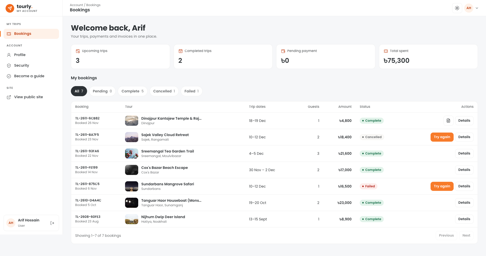
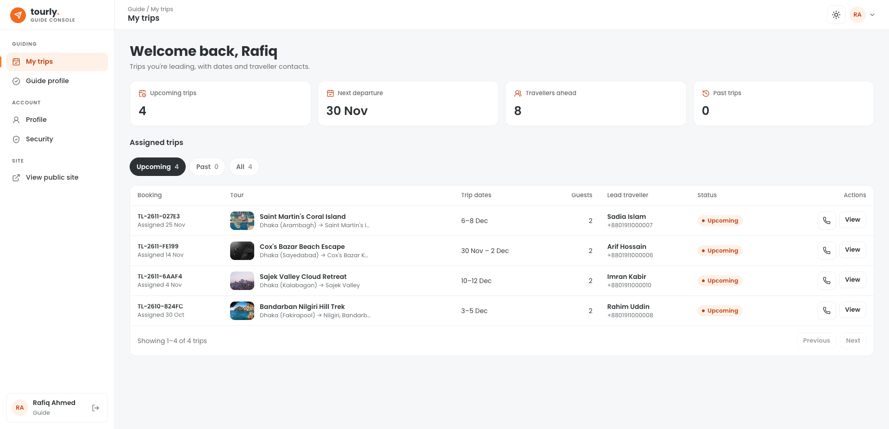
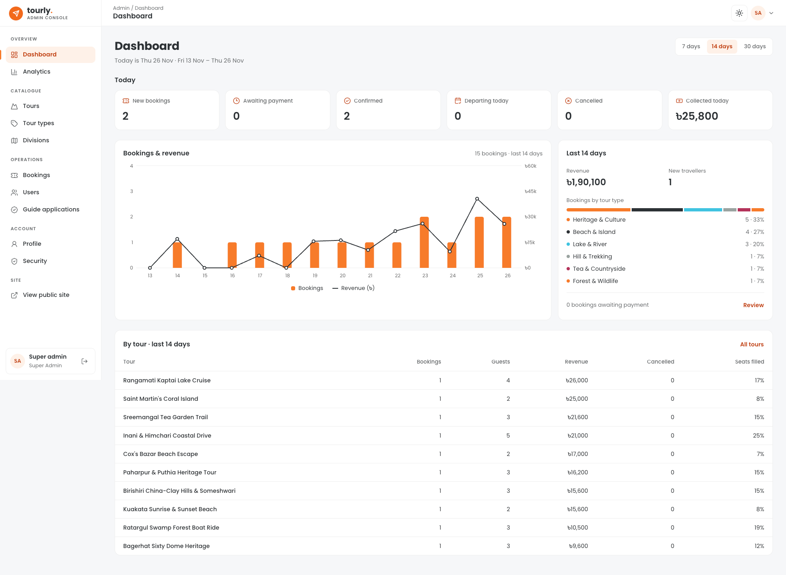
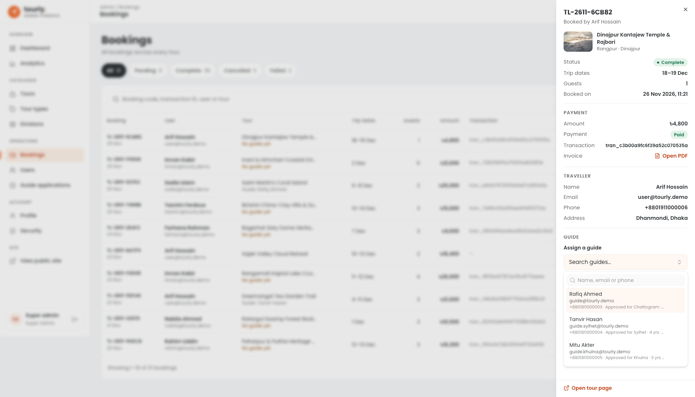

# Tourly

A full-stack tour booking platform for Bangladesh. Travellers browse tours across all eight divisions, book seats and pay online with SSLCommerz. Admins run tours and bookings and assign local guides, and guides see the trips they are leading.

**Live demo:** https://tourly.dev.cv
**API health:** https://tourly.dev.cv/api/v1/health


---

## Demo accounts

All demo accounts use the password `Tourly@2026`. The demo data is reset every night, so feel free to click around.

| Role        | Email                    | What to try |
| ----------- | ------------------------ | ----------- |
| Super admin | `superadmin@tourly.demo` | Everything an admin can do, plus promoting users to admin or super admin |
| Admin       | `admin@tourly.demo`      | Analytics, assign a guide to a booking, approve or reject a guide application |
| Guide       | `guide@tourly.demo`      | Assigned trips with traveller details |
| User        | `user@tourly.demo`       | Upcoming and past trips, retry a failed payment, book a new tour |

> Payments run on the SSLCommerz **sandbox**, so no real money is charged.

---

## Screenshots

### Public site and booking

| Tours with filters | Tour details and booking |
| --- | --- |
|  |  |

| SSLCommerz checkout (sandbox) | Payment result |
| --- | --- |
|  |  |

### User and guide

| My bookings | Guide dashboard |
| --- | --- |
|  |  |

### Admin

| Overview and analytics | Bookings and guide assignment |
| --- | --- |
|  |  |

---

## Features

### Public site
- Home page with live stats, trending tours, divisions and search
- Tour list with search, division, tour type and price filters, sorting and pagination
- Tour details with day-by-day plan, inclusions, seats left and booking
- About, help centre with FAQ search, cancellation policy and terms

### Traveller
- Sign up with email OTP verification, Google sign-in, forgot and reset password
- Book from the tour page and pay with SSLCommerz; seats are held for 30 minutes
- PDF invoice generated on payment, uploaded to Cloudinary and emailed
- My bookings (upcoming, past, cancelled), retry a failed payment, cancel a pending booking
- Profile with photo upload, change or set password
- Apply to become a guide and track the application

### Guide
- Assigned trips (upcoming and past) with trip details
- Traveller phone and email shared only close to the trip date

### Admin
- Overview and analytics dashboards (revenue, bookings, new users) with Recharts
- Create and edit tours with image upload, tour types and divisions
- Bookings with search, filters, CSV export and status changes
- Assign a guide to a paid booking, with division matching and date-clash checks
- Review guide applications (approve makes the user a guide, reject with a note)
- Users: change roles, block and unblock

### Platform
- Role-based access control: `SUPER_ADMIN`, `ADMIN`, `GUIDE`, `USER`
- Booking and payment written in one MongoDB transaction
- Background jobs: expire unpaid bookings after 30 minutes, move expired demo tours to new dates
- JWT access and refresh tokens in HTTP-only cookies, OTP codes in Redis
- Responsive UI with light and dark mode

---

## Tech stack

| Layer    | Tech |
| -------- | ---- |
| Frontend | React 19, Vite, TypeScript, Redux Toolkit (RTK Query), React Router, Tailwind CSS v4, shadcn/ui, React Hook Form, Zod, Recharts |
| Backend  | Node.js, Express 5, TypeScript, MongoDB (Mongoose), Redis, Zod, Passport (Google OAuth), JWT |
| Services | SSLCommerz (payments), Cloudinary (images and invoices), Nodemailer (SMTP), PDFKit |
| Security | Helmet, rate limiting, HTTP-only cookies, request validation |
| DevOps   | Docker, Docker Compose, GitHub Actions CI/CD, GHCR, Nginx, Cloudflare, VPS |

---

## Architecture

```
Browser
   │
   ▼
Cloudflare ──▶ Nginx (VPS)
                 ├── /api/*  ──▶  Express API (server)  ──▶  MongoDB (replica set)
                 │                     │                ──▶  Redis (OTP)
                 │                     ├── SSLCommerz (payments, IPN)
                 │                     ├── Cloudinary (images, invoices)
                 │                     └── SMTP (emails)
                 └── /*      ──▶  React app (client, static files)
```

The client and API share one domain, so the browser calls `/api/v1` and auth cookies stay first-party.

```
tourly/
├── client/      # React + Vite app (public site, user, guide and admin dashboards)
├── server/      # Express + Mongoose API (modules: auth, user, tour, division, booking,
│                #   payment, guideApplication, stats, otp) + seed scripts and jobs
├── deploy/      # Production docker-compose, deploy.sh, backup.sh, env examples, nginx config
└── .github/     # CI and deploy workflows
```

---

## Getting started

### Requirements
- Node.js 24+
- pnpm
- MongoDB running as a replica set (MongoDB Atlas works), because bookings use transactions
- Redis (local or Docker)

### 1. API

```bash
cd server
cp .env.example .env          # fill in DB_URL, secrets, SMTP, Cloudinary, SSLCommerz sandbox
pnpm install
pnpm seed                     # demo divisions, tours, users and bookings
pnpm dev                      # http://localhost:5000
```

Generate each JWT secret with `openssl rand -base64 32`. For Redis only: `docker compose up -d redis`.

### 2. Client

```bash
cd client
cp .env.example .env
pnpm install
pnpm dev                      # http://localhost:5173
```

### Run everything with Docker

```bash
cp .env.example .env                 # REDIS_PASSWORD
cp server/.env.example server/.env   # app secrets
docker compose up --build            # web :5173, api :5000
```

### Useful scripts (API)

| Script | What it does |
| ------ | ------------ |
| `pnpm check` | Typecheck and lint |
| `pnpm seed` | Create demo data; safe to run again, it skips what already exists |
| `pnpm seed:fresh` | Delete the demo data and create it again |
| `pnpm tours:rollover` | Move expired demo tours to new dates now (also runs every 6 hours in the server) |

---

## CI/CD and deployment

- **CI** (`ci.yml`): on every push and pull request, typechecks, lints and builds the server and the client.
- **Deploy** (`deploy.yml`): on push to `main`, runs CI, builds Docker images for `api` and `web`, pushes them to GHCR, then deploys to the VPS over SSH.
- **`deploy/deploy.sh`** pulls the images, starts MongoDB and Redis, starts the apps and waits for the health check.
- **Demo reset:** a nightly cron runs `seed-demo.js --fresh` so the public demo always starts clean.
- **Rollback:** `IMAGE_TAG=<old git sha> ./deploy.sh`

---

## Author

**Md Arif Uddin** · [GitHub](https://github.com/arifucoder)
